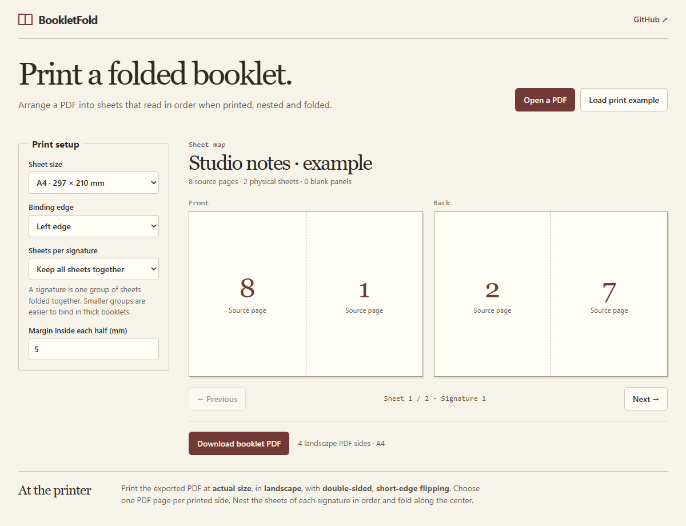

# BookletFold

Turn a reading-order PDF into a folded zine, course handout or pocket guide. BookletFold lays out the front and back of each physical sheet, adds blank panels where needed, and shows how the sheets nest before you print.

**[Try the eight-page print example](https://sutinah12-hash.github.io/bookletfold/#demo)** · [Open the tool](https://sutinah12-hash.github.io/bookletfold/) · [Download the offline HTML](https://github.com/sutinah12-hash/bookletfold/releases/download/v0.1.0/bookletfold.html)

## Make a booklet

1. Open a print-ready PDF or try the included eight-page guide. The sheet map shows **source page numbers** for each half of the paper.
2. Choose A4 or US Letter, the binding edge and a panel margin. For thick documents, set the maximum number of sheets per signature. Each signature is a group you fold separately.
3. Download the booklet PDF. Print it at **actual size**, in **landscape**, **two-sided**, **flipping on the short edge**. Select one PDF page per printed side. The exported PDF already contains the two-up layout.
4. Nest the sheets of each signature in order and fold at the center. Use the example first to check your printer's duplex setting.

For an eight-page left-bound booklet, the outside sheet reads **8 | 1** on the front and **2 | 7** on the back. The inside sheet reads **6 | 3** and **4 | 5**. Right binding swaps the two halves of every side.

## Command line

After `npm ci`, the same layout engine is available from the terminal.

~~~sh
node bookletfold.mjs input.pdf output.pdf --paper Letter --binding left --sheets 4 --margin 5
~~~

Use `--sheets 0` for one signature. Margins are in millimeters. The command requires a new output filename.

## Input and output

- Each source page is fit proportionally into its half-sheet, respecting the visible crop box and quarter-turn page rotation. Text and vector artwork are embedded directly.
- Padding is added at the end of the last signature. Empty source pages retain their place.
- Use an unlocked PDF. Flatten a copy of forms or marked-up pages first so their printed appearance is included. Ordinary links become printed page content without clickable targets.
- Processing happens on your device. The browser and CLI produce separate print PDFs.

## Development

Requires Node.js 20.19 or later. From the repository root:

~~~sh
npm ci
npm run build
npm test
npm run test:browser
~~~

The browser test uses a local Chrome installation with networking disabled. Set `CHROME_PATH` to use another Chromium executable. The build emits the single-file app in `docs/index.html`. Tests cover padded page counts, nested signatures, right binding, crop origins, rotated pages, blank originals and the dimensions of the exported PDF.

BookletFold is released under the [MIT license](LICENSE). The downloadable HTML includes the applicable licenses.
